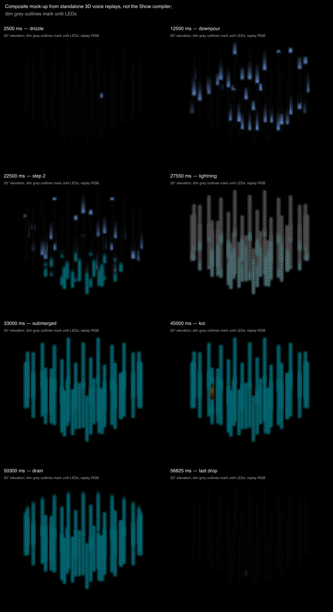
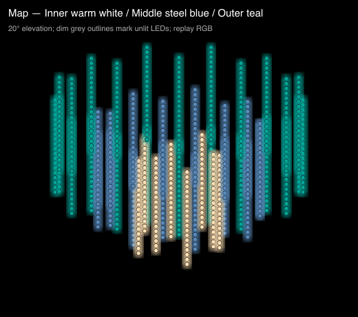
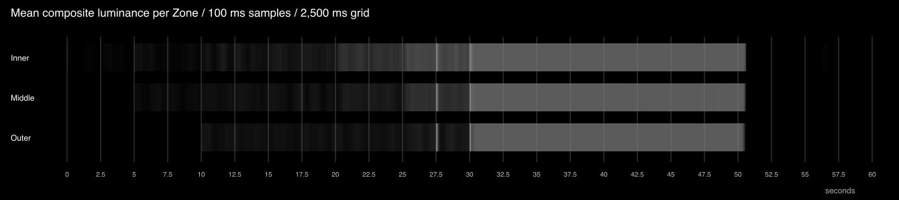

# Cloudburst: Visual Direction Packet and Visual Performance Plan

## Current status (#1200)

Cloudburst is built as the stock Installation Show
`stock-show-installation-cloudburst` (`cloudburstInstallationV2` in
`src/pixelblaze/stock/showsV2.ts`), Installations order 6, on the 960-LED
`cloudburst-chandelier` map. #1198 has landed: a 3D Installation Stage now
delivers a render3D member's xyz, so the Show renders.

- **Accepted compressed opening** ([decision](https://github.com/jon-whiteroomsoftware/PXLBLZ-IDE/issues/1200#issuecomment-6386444623)). The authored opening
  is compressed from 15 s to 4 s; all later events move 11 s earlier. The
  deterministic loop is 49 s. Rain enters Inner at 0, Middle at 1.333 s and
  Outer at 2.667 s. Water starts accumulating at 4 s and completes its first
  rise at 4.625 s. Subsequent rise starts are 9, 14 and 19 s; full submersion
  holds from 19.625 to 29 s. Jon accepted Cloudburst; publication is separate.
- **Score B values retained** ([decision](https://github.com/jon-whiteroomsoftware/PXLBLZ-IDE/issues/1200#issuecomment-6337003222)):
  three shared instances (TubeRain3D, LumaPlane3D, Koi3D) over three physical
  Zones (Inner, Middle, Outer). Cool rain; four held teal levels, each rise and
  the drain one 625 ms beat; the last rise at 19 s covers every ring. There is
  no white. One gold koi swims a full ten seconds (29-39 s) on the Middle ring:
  slow cruise, three sharp darts at 31, 34 and 37 s with soft releases, then
  slow cruise again. A Show-owned time-scale track preserves Koi3D and its controls.
- **Accepted water-key deviation.** The water Clips' luma key (target 0,
  tolerance 0.20, softness 0.05) is an accepted deviation (decision
  6337003222). Its margin is raw dry luma below 0.20 and submerged luma above
  0.25 in every applicable Zone, in Fast and Precise. No threshold tuning.
- **Coda: row 8 values, retimed.** Inner rain coda Clip 44.000-48.375 s, visible Speed 0.12,
  Density 0.0575. A zero-opacity continuation of the shared rain instance from
  19.625 to 29 s applies Speed 0.29565285996055224. Shared member continuity
  retains that Speed and advances `beforeRender` without rain pixel evaluations
  from 29 to 44 s, restoring the accumulated flow removed by the 11 s
  compression; visible rain keeps Speed 0.12. With the accepted darts merged,
  the opening before 29 s and coda from 44 through 49 s preserve every RGB
  channel against frozen `a16eb1bc` in Fast/Precise at 30/60 fps.
  The premise is exactly "the last drops
  fall through the empty dark": one to three complete Inner-tube drops, at
  most two at once; each head enters at the top and each tail leaves the
  bottom before the Clip closes
  ([R decision](https://github.com/jon-whiteroomsoftware/PXLBLZ-IDE/issues/1200#issuecomment-6339423482),
  [final ruling](https://github.com/jon-whiteroomsoftware/PXLBLZ-IDE/issues/1200#issuecomment-6339784729)).
  Delivered replay measures one drop in Fast and two in Precise at 30/60 fps,
  retaining their measured first-light times relative to drain.
- **Drain tolerance.** Darkness begins one frame after the drain key, at
  39.625 + 1/fps seconds at the replay's rate (#1204). From there every frame is
  exactly black until the first coda light, at least 2.5 s later. The
  TubeRain3D head-entry fix is separate (#1206).
- **Measured combined artifact.** 52,024 compiled bytes, 54,192 delivered
  source bytes, 125 persistent globals, 2,908 ledger words plus 3,840 rain
  geometry words: 6,748 bounded VM words, no blockers. Limits remain
  68,384 B, 256 globals and 10,240 words. At 30 fps, keyed water first exceeds
  RGB sum 0.02 at 4.033 s in both modes; 4 s is the authored start.
  The dart track adds 1,806 source bytes and no globals or words to AH9.
- **Proof.** `src/engine/cloudburstShow.test.ts` judges the exported EPE
  through `parseEpe` and the fast replay on the real map. The exported
  historical [`cloudburst.pxlshow`](../proof/cloudburst-show/cloudburst.pxlshow) and
  [`cloudburst.epe`](../proof/cloudburst-show/cloudburst.epe) live in
  `docs/proof/cloudburst-show/`, with historical Stage captures. These artifacts
  predate AH8. Combined reopened exports, cadence measurements and capture
  commands are saved under `.wrsp/1200-combined/` for the developer's handoff.
  Dart motion uses paired exported runtimes with identical seeds, cadence and
  prior dart history: removing only the current boost supplies its cruise
  counterfactual over the same rendered gold-centroid window. The required
  rate increase remains at least 3×; an independently replayed candidate
  with that boost removed must fail the same check.
- **Unmeasured.** Hardware bytecode, physical frame rate and physical colour.

Everything below is the #1193 design record, kept as history. Its two
lightning hits and its exactly-one-drop coda are superseded proposals: score B
has no white, and the coda follows the R rulings above.

## Design record

Design for #1193 (parent #1191). The build was a separate
`work:implementation` child (#1200). Jon delegated his approval gates on
2026-10-21, as relayed by the eng lead and recorded on #1193, so the
[decisions](#decisions-at-jons-gates) below are the principal engineer's
recommendations recorded as decisions.

**Recommendation in one paragraph.** Build Cloudburst as the first Installation
Show on a 3D map: a 960-pixel chandelier of 48 hanging tubes in three rings,
hung as a bowl so the inner ring hangs lowest. Rain falls through the dark tubes
while a horizontal waterline rises in four held steps. The water takes the
inner ring first, then the middle and the outer, until it covers everything.
Under the water nothing moves until a single gold koi swims one lap. Then the
water drains in one beat, and one last drop falls. Three small new Patterns
carry it:
- **TubeRain3D**, the rain;
- **LumaPlane3D**, the plane-sweep member of the Luma 3D family, as the
  waterline;
- **Koi3D**, the koi.

The epic's draft voices fail on this map, as measured in the
[probe record](#probe-record): CrystalRain3D, TempestVolume3D and ShoalScatter3D.
At design time the build was blocked: the Show compiler had no 3D output
dimension, so a render3D voice on a 3D Stage compiled to black with no refusal
(#1198, since fixed).

## Visual Direction Packet

### Intent and audience

- An Installation Show for a physical chandelier of hanging LED tubes, and the
  catalogue's first Show on a 3D Stage.
- It shows that a Show can author space in 3D: one horizontal plane, read
  across tubes that hang at different heights, carries the whole piece.
- Audience: Pixelblaze builders and the PXLBLZ catalogue. The fixture can be
  built from one strip cut into 48 equal tubes.
- Form: ambient weather theatre, 60 seconds, looping from one drop to the next
  drizzle.

### Governing premise

**Above the waterline everything falls; below it nothing moves.**

- Rain falls through a dark chandelier. Water rises in held steps and takes
  the rain ring by ring until only stillness is left.
- Inside the stillness one warm thing moves. Then the water lets go in one
  breath, and a single drop falls through the empty dark.
- The waterline is the only horizon. It stays legible in 3D because the
  tubes hang at different heights: a level plane crosses each ring at a
  different place on its tubes.

### Graphic grammar

- **Dominant silhouette:** the waterline, a level edge cutting across tubes,
  lit still below and dark above.
- **Supporting primitives:**
  - a drop: a bright head with a tail fading upward, travelling down one tube;
  - the water body: one even fill;
  - the koi: a single warm glow with a short tail.
- **Texture:** none in the water. The rain is the only texture, and it lives
  above the line.
- **Edges:** the waterline is crisp, one or two pixels of softness along a
  tube. Drop heads are hard and their tails soft.
- **Glyphs:** none.

### Hierarchy

| Section | Hero | Support | Background |
| --- | --- | --- | --- |
| Drizzle and downpour | the rain, spreading ring by ring | none | black air |
| Rising | the waterline | rain above the line | black air |
| Lightning | the whole chandelier, white | none | none |
| Submerged | the stillness itself | none | none |
| Koi | the koi | still water | none |
| Drain and last drop | the falling water, then one drop | none | black |

The waterline outranks the rain because it is the only edge that persists and
the only change that holds.

### Palette roles

- **Black** is air and the night: everything above the water.
- **Steel blue** is rain, desaturated and cool so it reads as falling light,
  not colour.
- **Deep teal** is water: one even level, darker than a drop head and brighter
  than the air.
- **White** is lightning only, twice.
- **Gold** is the koi, once. It is the intruder, the only warm hue in the
  piece, and it leaves before the drain.

### Motion verbs

- **Fall.** At three scales: a drop down one tube, the whole water body in the
  drain, and the last drop. The drain is the water falling like rain.
- **Rise.** Only in stairs: each step lands on a beat and then holds.
- **Hold.** The water between steps, and the submerged stillness.
- **Swim.** Once, the koi: the only motion that is neither falling nor rising.

### Timing hierarchy

- **Pulse:** 96 BPM, a 625 ms beat. Each rise and the drain take exactly one
  beat.
- **Development unit:** one bar, 2.5 s. Rain density steps and ring entries
  land on bar lines.
- **Phrase:** two bars, 5 s. The water holds each step for one phrase.
- **Arc:** 24 bars, 60 s, looping.
- Rain itself is free-running and irregular, while every structural change
  lands on the grid. Weather is irregular and the water is not.

### Phrase arc

| # | Section | Bars (time) | What happens |
| ---: | --- | --- | --- |
| 1 | Drizzle | 1-2 (0-5 s) | Sparse drops on the inner ring only. |
| 2 | Downpour | 3-6 (5-15 s) | The middle ring joins at 5 s and the outer at 10 s, with density stepping up at each entry. |
| 3 | Rising | 7-12 (15-30.6 s) | Four held steps at 15, 20, 25 and 30 s. Step 1 takes the bottoms of the inner tubes, step 2 the middle ring's, step 3 the outer ring's, and step 4 everything. |
| 4 | Lightning | 27.5 s and 30 s | Two white hits. The second lands with the last rise, so the storm's peak pushes the water over the top. |
| 5 | Submerged | 13-16 (30.6-40 s) | Still teal everywhere. Nothing moves. |
| 6 | Koi | 17-20 (40-50 s) | One gold koi swims one lap around the middle ring, fading in and out over a bar. |
| 7 | Drain | 50-50.6 s | One beat: the water falls through every ring at once. |
| 8 | Last drop | 21-24 (50.6-60 s) | Darkness, then exactly one drop down one inner tube. The loop seam runs from that drop into the drizzle. |

### Invariants

- The waterline is level: one height across all 48 tubes at every instant.
- Nothing moves below the waterline except the koi.
- Rain exists only above the waterline.
- Water changes level only in beat-long rises and the one drain.
- White appears only in the two hits, and gold only in the koi section.
- The arc starts and ends with rain on the inner ring alone.

### Permitted variations

Rain density and speed; the number of rising steps (three to five, each still
ring-aligned); the koi's path and lap time; the hit times, provided each stays
on a structural boundary.

### Signature frames and impact moments

- **Rising (22.5 s):** rain on the outer ring above a level teal line that
  already holds the inner ring and the bottoms of the middle ring. In one
  frame it must read as "water rising in a rainstorm".
- **Submerged (33 s):** the whole chandelier one still teal object.
- **Koi (45 s):** one gold glow in the teal.
- **Impact moments:**
  - the last rise under the second hit (major);
  - the koi's entrance (the turn);
  - the drain (the release);
  - the last drop (the coda).

### Restraint rules

- No texture under water, and no shimmer or caustics: stillness is the
  material.
- At most two moving things at once: rain and the line, or the koi alone.
- Rain never crosses the waterline.
- White twice, gold once, and the last 7.5 s almost entirely black.
- The piece must still read with the lightning removed. The fourth rise
  carries the climax on its own; the hits only amplify it.

### Known failure modes

- **Rain reads as sparkle, not falling.** Drops need a head-and-tail shape and
  consistent downward travel on every tube. The drop speed must suit the
  Controller's frame rate, which is likely below 15 FPS here (see the
  [cost envelope](#cost-envelope)).
- **The waterline is lost in 3D.** If every tube hangs at the same height, a
  level plane lights the same pixel row everywhere and the frame flattens into
  a band. The bowl and the hem stagger keep the steps legible.
- **Still water reads as "off".** The water must sit clearly above black and
  carry a crisp edge, so that submerged reads as full rather than frozen.
- **The koi reads as a bug or a light leak.** It needs a body and a tail
  moving along a smooth path, not a blob blinking between tubes.
- **Lightning overloads the power supply.** 960 pixels at 0.5 white draw about
  29 A at the commonly quoted 60 mA per pixel at full white. Cap the hit and
  confirm it against the supply.

### Rejected alternatives

- **Churning water** (TempestVolume3D's currents and foam). It is
  beautiful, but motion under the water breaks the law. Its fill axis is z, so
  its waterline would stand vertical on this map.
- **A z-up map** to suit TempestVolume3D. The rain would fall sideways, and
  the 3D preview, which turns about y and draws +y up, would show the
  chandelier lying on its side.
- **A shoal at the peak** (ShoalScatter3D). It reads as seven scattered blobs
  over a lit blue background, not one creature.
- **One combined Pattern** for rain, water and koi. It would be the cheapest
  per pixel, but it moves palette and composition into a Pattern and gives
  the 3D Stage no reusable vocabulary. It is kept as the last fallback rung.

### Impact rubric scores

Scored against
`.claude/skills/design-compelling-pxlblz-visuals/references/impact-rubric.md`.
The draft column scores the concept in #1191 section 2; the refined column
scores this packet.

| Dimension | Draft | Refined | Why |
| --- | ---: | ---: | --- |
| Premise | 2 | 3 | The draft named events (rain, rising, drain). The refined law gives one inferable rule: falling above the line, stillness below. |
| Hierarchy | 2 | 3 | The waterline is the one persistent edge. Rain supports it and never crosses it, and the koi takes over only once the rain is gone. |
| Palette roles | 3 | 3 | Structural: black air, cool rain, still teal, white twice, gold once. |
| Motion grammar | 2 | 3 | Fall at drop, body and coda scale; rise only in stairs. The drain reuses the rain's verb at the scale of the whole water body. |
| Temporal form | 2 | 3 | Ignition, spread, staircase, peak, vacuum, intrusion, release, coda, with the last drop seaming into the first drizzle. |
| Restraint | 2 | 3 | Stillness is the material under water. The last quarter is nearly black. |
| Ordinary frame | 2 | 2 | The rising frame reads as weather plus a level, as the [storyboard](#storyboard) shows. Residual risk: on hardware the rain may step rather than flow at the estimated frame rate. |
| Surprise | 2 | 3 | The first warm, non-vertical motion appears inside total stillness, and the release follows on one beat. |

Every dimension scores at least 2, so no redesign was needed. Ordinary frame
is the weakest, and the plan protects it through drop speed and pixel density.

### What changed from the draft

1. The law is restated around falling against stillness. The draft's
   "submerged silence" is promoted from a section to the governing rule.
2. The water is still. TempestVolume3D's churning body is rejected on the law
   and on its axis.
3. The chandelier hangs as a bowl, inner ring lowest. Each rise therefore
   takes one ring, and the water rises centre-first just as the rain spreads
   centre-first.
4. The second hit lands with the last rise, so the lightning causes the
   submersion instead of decorating it.
5. The koi is one body. The shoal is rejected.
6. The last drop is exactly one drop, timed from the deterministic replay.
7. The arc is laid out on a 96 BPM grid: 24 bars, 60 s.

## Decisions at Jon's gates

Jon delegated these gates on 2026-10-21 ("Delegate Cloudburst too", relayed
by the eng lead and recorded on #1193). Each is recorded on #1193 with its
evidence.

1. **Approval of the packet and the plan.** Approved by delegation: every
   rubric dimension scores at least 2.
2. **The plane-sweep Luma 3D member is in scope.** LumaPlane3D is
   Cloudburst's waterline and is built with this Show. The shell and helix
   members stay with the Luma 3D family child.
   - Evidence: it produces a level, crisp waterline whose four steps take
     each ring in turn (inner 0.1, 0.4, 0.7, 1; middle 0, 0.1, 0.4, 1; outer 0,
     0, 0.1, 1). No existing voice gives a horizontal plane on a y-up map.
3. **The voices are replaced.** TubeRain3D replaces CrystalRain3D, LumaPlane3D
   replaces TempestVolume3D, and Koi3D replaces ShoalScatter3D. The reasons are
   in the [probe record](#probe-record).
4. **Homes for the new Patterns.** LumaPlane3D goes in Luma Sources and meets
   the Luma family contract. TubeRain3D and Koi3D go in the new Show
   Ingredients rail section, which lane S (#1196) is adding. All three stay
   out of the Gallery.
5. **The Show record waits for #1198.**
   - The eng lead classifies #1198 as a silent-black defect fix, like #1197,
     and queues it once #1197's change to `showCompiler.ts` lands.
   - Meanwhile the build child starts on the pieces that don't depend on it:
     the chandelier map and the three Patterns, each proved alone in the 3D
     Pattern preview.
   - The Show record is built after a 3D Installation Stage renders a render3D
     member's xyz.
6. **The koi laps the Middle ring.** The draft figure-eight is replaced by a
   lap on the Middle ring's radius, a permitted variation.
   - Evidence (probe C rerun): the figure-eight was dark on 148 of 300 lap
     frames, and the ring lap at Size 0.75 on none.

## Visual Performance Plan

Written to the contract in
`.claude/skills/co-design-pxlblz-visual-performance/references/visual-performance-plan.md`.
Three probes produced the figures (the [probe record](#probe-record)):
- **A** measured the map, the axes and each voice through standalone 3D
  replay;
- **B** compiled the draft score through the production path;
- **C** composited the planned voices for the storyboard and the flash check.

B's compile could not deliver 3D pixels (#1198), so its byte figures describe
an artifact without working render3D calls. Frame rates are estimates scaled
from measured pb32 anchors. Every estimate is labelled.

### Target

- **Artifact:** an Installation Show in the Installations collection, with an
  installation output contract on a new stock 3D map (working id
  `cloudburst-chandelier`) at exactly 960 pixels.
- **Duration:** 60 s, a deterministic loop.
- **Controller:** Pixelblaze 3 (pb32 class, firmware 3.67). Exploratory, but
  specified so it can be built.
- **Stage:** three physical Zones, one per ring. Each ring is wired as one
  run, and each tube is wired top to bottom.

| Zone | Tubes | Radius (m) | Index range | Pixels |
| --- | ---: | ---: | ---: | ---: |
| Inner | 8 | 0.20 | 0-159 | 160 |
| Middle | 16 | 0.40 | 160-479 | 320 |
| Outer | 24 | 0.60 | 480-959 | 480 |

**Map layout.**
- **Tubes:** 20 pixels each at 25 mm pitch, 0.5 m long, with the first pixel
  half a pitch below the tube top.
- **Bowl:** tube tops hang 0, 0.15 and 0.30 m below the ceiling for the
  outer, middle and inner rings.
- **Hem stagger:** even-numbered tubes in each ring hang a further 0.06 m
  lower.
- **Ring origins:** the outer ring starts at angle 0, the middle is offset by
  half its step and the inner by a quarter of its step.
- **Axes:** y is vertical and points up, matching the 3D preview's turntable
  axis and +y-up drawing (`src/engine/camera.ts:211-215, 350-360`).
- **Normalization:** `normalizeAspect` divides every axis by the 1.2 m
  extent, giving x and z in [0, 1] and y in [0, 0.696].
- **Source:** a function of `pixelCount` with 48 tubes fixed and pixels per
  tube = `pixelCount / 48`. Density can then fall without changing the
  topology or the score.

| Ring | Bottom LED y (even / odd) | Top LED y (even / odd) |
| --- | --- | --- |
| Inner | 0.000 / 0.050 | 0.396 / 0.446 |
| Middle | 0.125 / 0.175 | 0.521 / 0.571 |
| Outer | 0.250 / 0.300 | 0.646 / 0.696 |

### Protected visual purchase

The level waterline rising in held, ring-aligned steps across tubes of
staggered height, with rain only above it and stillness below. Four things
are never cut: the level plane, the four ring-aligned steps, the stillness
under water, and the one-beat drain.

### Visual grammar

**Implementation grammars for the waterline**, compared:

| Grammar | Artifact and state | Active render | Verdict |
| --- | --- | --- | --- |
| **A. LumaPlane3D under color-map and luma key**, Offset on a held track | A small Pattern; about 12 keys | One dot product and a smoothstep per pixel, plus three Effect lines | **Chosen**: level by construction, and reusable 3D vocabulary |
| B. TempestVolume3D's `sliderWaterLevel` | An existing Pattern | Heavy: three wave systems, three current fields, flecks | Rejected: z axis, so the line stands vertical; churn breaks the law |
| C. A combined rain-and-water Pattern with a Level control | One new Pattern | One evaluation per pixel and no keys | Fallback rung 4: cheapest, but no reusable vocabulary and palette moved into a Pattern |
| D. Per-tube opacity keys | No new Pattern | None | Rejected: one Zone is a whole ring, so this cannot cut a level line across tubes of different heights |

**LumaPlane3D**, the plane-sweep member of the Luma 3D family:
- **Family core:** LumaStripes' core (crest, Feather, Lean, Invert and the
  exact-loop clock) over a 3D phase geometry, the signed distance along a
  normal set by Tilt and Azimuth.
- **New controls:** Tilt, Azimuth and Offset, an animatable phase shift in
  periods.
- **Spacing:** its range extends to a pitch of 2.0, so one band can span the
  Stage.
- **Waterline settings:**
  - Direction hold, Spacing 1, Width 0.5, Feather 0.04, Lean 0.5, Tilt 0;
  - Offset = y_s / 2 for a surface at normalized y_s.
- **Measured:** submerged pixels at least 0.79, with a 1-2 pixel edge on each
  tube the line crosses. Full submersion has a minimum of 0.98 and no lit air.

**TubeRain3D**, the rain:
- Each tube carries its own drops, hashed from the tube's x and z.
- Each drop is a bright head with a squared tail above it, falling along
  world y.
- A per-drop gate sets density without heads popping in mid-tube: zero
  mid-tube appearances were measured.
- It emits its own colour through Hue and Saturation, so the rain needs no
  Effect line.
- Measured: every one of the 48 tubes rains at every density, against 8 of 48
  for CrystalRain3D.
- The build fixes the probe's negative phase: `frac` of a negative argument
  went outside [0, 1), so the build uses a positive modulo.

**Koi3D**, the koi:
- One glow plus two trailing glows on a closed lap around the Middle ring's
  radius, with a small radial wobble, at mid-water height.
- The lap follows a ring, not the gaps between rings. The draft figure-eight
  ran mostly through empty space between tubes and was dark for about half of
  each lap (probe C; see the [probe record](#probe-record)).
- The glow radius covers at least half the tube pitch at the lit threshold,
  so the body always touches a tube (the probe's Size 0.75).
- An exact loop through a Loop Interval control, with Size, Hue and Height.
- Squared distances only, so there is no `sqrt` per pixel.

**Colour and keys:**

| Clip | Effects, in order |
| --- | --- |
| Rain (Main) | none (TubeRain3D emits steel blue: Hue 0.6, Saturation 0.55) |
| Water (Layer 2) | color-map black to teal (0, 0.45, 0.50); solid white color-map (0.5, 0.5, 0.5) with an animated amount, the lightning; luma key removing black |
| Koi (Layer 3) | luma key removing black (Koi3D emits gold: Hue 0.09) |

Lightning sits on the water Clips only, before the key. At amount 1 the whole
water layer is white, including the air that the key would otherwise remove.
One Effect line therefore whitens the entire chandelier over the rain beneath.
The key reads the luma after the Effects before it in authored order
(`src/engine/showEffects.ts:293, 311-313`, confirmed by probe B).

### State and identity plan

| Instance | Pattern | Serves | Why it has its own identity |
| --- | --- | --- | --- |
| `rain` | TubeRain3D | Rain Clips on all three Zones | One clock, so a drop that crosses ring entry times stays continuous; Density on a held track |
| `water` | LumaPlane3D | Water Clips on all three Zones | One Offset track keeps the line level across Zones; it must run Stage-wide (`span`) |
| `koi` | Koi3D | Koi Clips on all three Zones | Its own clock starts the lap at 40 s |

Clips:
- **Rain:** Inner 0-30.625 s plus a short coda Clip for the last drop; Middle
  5-30.625 s; Outer 10-30.625 s.
- **Water:** all three Zones, 0-60 s.
- **Koi:** all three Zones, 40-50 s, with an opacity fade in over the first bar
  and out over the last.
- Every property track spans its Clip's lifetime. The lightning keys sit
  inside the water Clips' amount track; they add no Clip edge.

Water must read Stage-wide coordinates in every Zone, or each ring would
place its own line. That is unproved until #1198 defines what a render3D
member sees inside a physical Zone; the authoring helper's Clip already sets
`zoneSampleMode: 'span'`.

### Cost envelope

| Ledger | Budget | Planned peak | Evidence or uncertainty |
| --- | ---: | ---: | --- |
| Pattern/source bytes | none set | about 0.6-1.2 KB per new Pattern | Probe sources |
| Production artifact bytes | 68,384 B activation proxy (`test/perf-harness/issue514.test.ts`) | about 45-55 KB, estimated | B measured 63,641 B for the draft score with CrystalRain3D, ShoalScatter3D and six lightning Effects, but on an artifact without working render3D calls. Removing ShoalScatter3D's koi saved 21,130 B (V4) and removing the lightning 10,497 B (V5). The planned score carries a small Koi3D and lightning on three Clips. Re-measure first in the build |
| Globals and array words | 256 globals; 10,240 words | about 140 globals; about 3,000 words (7,250 remaining) | B: 137 globals and 2,990 words for the draft. Render target: 3 × (960 + 4) = 2,892 words |
| Render-target words | 3 × (N + 4) | 2,892 at 960 pixels | Ledger formula, `src/engine/showVmResourceLedger.ts:3-8` |
| Active Pattern evaluations | 5 renderers per pixel | 2 per pixel in rain and koi sections, 1 when submerged | B's compiled structure: 2/2/2 at the peak, 1/1/1 submerged |
| Effect lines per pixel | none set | 3 on water pixels, plus 1 on koi pixels from 40 to 50 s | Planned stacks; rain carries none |
| Frame time or FPS | 8 FPS working floor (proposed) | About 7-12 FPS, estimated | Estimate, not a measurement. Measured pb32 anchors at 1,000 px: a one-member Show with Vignette at 16.4 FPS (about 61 µs per pixel); a cheap HSV steady state at 10.3 FPS (`test/perf-harness/wave2-baselines.md`, before the #538 Effect-kernel sharing); Redline at 4.8 FPS. Adding a second cheap member and two more Effect lines gives about 105-140 µs per pixel at 960 px. No render3D Pattern has a hardware FPS measurement. `npm run devbench` on a pb32 replaces this estimate |

**Frame rate is the plan's main risk.**
- At 8 FPS, rain travelling 30-40 pixels per second jumps four or five
  pixels a frame, and a 20-pixel tube shows sparkle rather than falling.
- The plan therefore tunes TubeRain3D's Speed and Length for the floor:
  roughly 1.5-2 pixels per frame, with tails at least four pixels long, so
  consecutive frames overlap.
- The first fallback is pixel density: the map source re-solves at 720 or 576
  pixels without touching the score.

**Flash limit.**
- Lightning is two single flashes 2.5 s apart. Water rises are level
  changes, not flashes.
- Probe C measured the composite against the harness algorithm
  (`src/agent-harness/telemetry/harness.ts`): no violating area in any
  one-second window, and at most 2 Hz in any Zone. See the
  [probe record](#probe-record).

### Section and transition strategy

There are no Transitions. Every structural event is a Clip edge or a key
inside a Clip.

| Section | Time | Mechanism |
| --- | --- | --- |
| Drizzle | 0-5 s | Inner rain Clip; held Density key at 0.15 |
| Downpour | 5-15 s | Middle and Outer rain Clips start; Density keys at 0.5 and 0.85 |
| Rising | 15-30.6 s | Four Offset rises on `water`, each one beat long with cubic-out easing, then held |
| Lightning | 27.5 s, 30 s | The water Clips' white color-map amount jumps to 1 and decays over 400 ms on a cubic-out curve |
| Submerged | 30.6-40 s | Rain Clips end, saving one evaluation per pixel. Water alone |
| Koi | 40-50 s | Koi Clips on Layer 3 with opacity fades |
| Drain | 50-50.6 s | One cubic-in Offset fall over one beat |
| Last drop | 50.6-60 s | Inner rain coda Clip windowed so exactly one drop falls |

**Section cost.** B's draft compiled to 7 sections, and keeping the rain
Clips open to 60 s saved two (V2). Each section costs about 8.5 KB (#1192's
marginals). The plan accepts the rain Clip edges because ending rain under the
water saves an evaluation per pixel through a third of the Show, which is
where frame rate is scarcest. The build measures both shapes. Per #1197,
property tracks currently wrap past 32.767 s inside one compiled section; the
plan is designed to the fixed behaviour and does not split sections to dodge
it.

### Expensive purchases

- **The water layer:** one LumaPlane3D evaluation and three Effect lines on
  every pixel for the whole Show. It is the hero, and it carries the
  lightning too.
- **TubeRain3D on Main:** one evaluation per pixel for the first half. Rain
  is what the water takes away, so it must be convincing.
- **Koi3D on Layer 3 for 10 s:** the intruder. It is the first fallback to
  shorten.
- **Lightning on the water Clips:** one Effect line plus an amount track, in
  place of six Effects (V5's saving shows their price).

### Measurement plan

**First slices of the build.**
- Before #1198: the map and the three Patterns, each proved alone in the 3D
  Pattern preview, with their stock pieces.
- After #1198: a Show cut at the end of the rising section;
- record bytes, globals, words and sections;
- run `npm run devbench` on a pb32 for frame rate;
- tune TubeRain3D's speed for the measured frame rate before extending to the
  full score.

**Verification matrix:**
- **The map:** pixel count, Zone ranges, ring order, top-to-bottom wiring,
  and y up with the measured top and bottom table above.
- **LumaPlane3D:**
  - the Luma family contract (`src/pixelblaze/stock/patterns/lumaFamily.test.ts`),
    covering the shared ontology, the exact loop and phase continuity under
    animated controls;
  - a level-plane oracle: lit fraction per ring at the four step heights.
- **TubeRain3D and Koi3D:** the five stock pieces in
  `docs/agents/stock-content.md`; downward travel on a y-up map; zero
  mid-tube appearances; the koi lit on one or two adjacent tubes in every
  frame of its lap, never dark.
- **The Show:**
  - it validates, reopens and compiles with no blockers;
  - bytes are under the activation proxy and globals under 256;
  - the compiled replay shows the waterline at the same normalized y in every
    Zone.
- **Deterministic seek** through the rising section.
- **The flash limit** on a deterministic render: every second at or below
  25%.
- **Census re-pins** per `docs/agents/stock-content.md`, with unchanged
  verdicts, coordinated with the eng lead (shared catalogue files).
- **Real-Stage captures** (`?capture`) of the rising, submerged and koi
  frames on the 3D point cloud. The koi frame must show a gold body that
  reads against the teal; the mock-up's koi is a dim amber smudge (see the
  [storyboard](#storyboard)).
- **Hardware notes:** the steel-blue and teal balance, and the lightning's
  current draw.

### Fallback ladder

In order. Each rung keeps the premise.

1. **Pixel density.** Re-solve the map at 720 or 576 pixels. This changes
   frame rate only.
2. **The koi.** Shorten it to two bars, or drop its tail glows. The surprise
   weakens, but the law holds.
3. **Lightning.** Remove both hits. The fourth rise carries the climax on its
   own, and the restraint rule already requires that.
4. **The combined Pattern.** Fold rain and water into one Pattern with a Level
   control and its own two colours. This gives one evaluation and no keys,
   but gives up the reusable Luma 3D vocabulary.

### Handoff

To the build child (`work:implementation`), through
`build-efficient-pxlblz-patterns` and `compose-pxlblz-installation-shows`. The
map and the Patterns come first; the Show record follows #1198.
- **The map:** a stock source in `src/pixelblaze/stock/maps/sources/`, with
  its catalogue entry (dim 3) and tests.
- **The new Patterns:** LumaPlane3D, TubeRain3D and Koi3D, each with the five
  stock pieces, in the homes recorded above.
- **The Show:** built in `src/pixelblaze/stock/showsV2.ts` through the
  authoring helpers, with census re-pins in the fan-out order of
  `docs/agents/stock-content.md`. Tell the eng lead before editing shared
  catalogue files.
- **Proof:** real-Stage captures, the reopened artifact, devbench FPS, the
  flash measurement, and a morning preview note for Jon on the build child.

Open engine questions, all for #1198:
- what a render3D member sees inside a physical Zone;
- Stage-wide `span` sampling on 3D;
- whether Layers, keys and property tracks behave identically on the 3D
  output path.

### Probe record

The probes were temporary files, deleted before this plan was committed.
Their briefs are posted on #1193.

| Probe | Command | Answers |
| --- | --- | --- |
| A: map, axes and voices | `npx vitest run src/pixelblaze/stock/_cloudburst-a-voices-probe.test.ts` | Map tables; the axis conventions; coordinates inside a 3D Show; rain, shoal and waterline statistics |
| B: draft score and costs | `npx vitest run src/pixelblaze/stock/_cloudburst-b-*-probe.test.ts` | Validation and compile of the draft score; cost variants; the key's semantics; the 3D output gap |
| C: storyboard composite | `npx vitest run src/pixelblaze/stock/_cloudburst-c-storyboard-probe.test.ts` | Composite frames, score strip, flash check, koi and rain legibility |

**The open risks #1191 named, answered.**
1. **Axis conventions.**
   - CrystalRain3D's drops travel toward -y: down on a y-up map. On 30 frames
     of every tube, A measured 111 downward steps and 0 upward ones.
   - TempestVolume3D's water fills along z (`water = surface - z`,
     `src/pixelblaze/stock/patterns/TempestVolume3D.js:63`), a corrugated
     z-height field. On a hanging map whose height is y, its waterline is
     not horizontal.
   - The two voices cannot share a vertical axis on one map.
2. **The frame rate of two 3D voices.** No render3D Pattern has a hardware
   measurement. Estimated at 7-12 FPS for the planned cast at 960 pixels (see
   the [cost envelope](#cost-envelope)). Heavier draft voices would be slower.
3. **3D Stage support end to end.**
   - **Exists:** a 3D Stage for a stock Installation whose map spec has dim 3
     (`src/pixelblaze/stock/showsV2Compile.ts:13-18`); a 3D Stage preview draw
     (`src/engine/showEditorStagePresentation.ts:230-262`); validation and
     compile with no blockers.
   - **Missing:** a 3D output path. A render3D member is called on a
     synthesized line and the artifact renders black with no refusal (#1198).
     What a render3D member sees inside a physical Zone is therefore unproved.

**Voice measurements** (standalone 3D replay, probe A; 10 s at 30 fps):

| Voice | Setting | Tubes ever above 0.5 | Notes |
| --- | --- | ---: | --- |
| CrystalRain3D | density 0.1 / 0.45 / 0.8 | 8 / 8 / 8 of 48 | An x/z cell lattice: only tubes near a cell centre light. 18-46 tubes share phase groups. 9-32 px/s |
| TubeRain probe | density 0.15 / 0.5 / 0.85 | 48 / 48 / 48 | One phase per tube; 27-41 px/s downward; zero mid-tube appearances |
| ShoalScatter3D | defaults; schooling 1, fear 0.2 | about 7 lit tubes in 7 separate blobs | Background 0.03-0.3 on most pixels, so a black key leaves a blue haze; reads as scatter |

**LumaPlane3D waterline** (probe A), lit fraction per ring:

| Water height | Surface y_s | Offset | Inner | Middle | Outer |
| --- | ---: | ---: | ---: | ---: | ---: |
| Covers inner bottoms | 0.060 | 0.030 | 0.10 | 0 | 0 |
| Covers middle bottoms | 0.185 | 0.0925 | 0.40 | 0.10 | 0 |
| Covers outer bottoms | 0.310 | 0.155 | 0.70 | 0.40 | 0.10 |
| Covers everything | 0.716 | 0.358 | 1 | 1 | 1 |

**Draft score cost variants** (probe B), on an artifact without working
render3D calls:

| Variant | Bytes | Globals | Words | Sections |
| --- | ---: | ---: | ---: | ---: |
| V1: draft score (CrystalRain3D, LumaPlane3D, ShoalScatter3D, lightning on six Clips) | 63,641 | 137 | 2,990 | 7 |
| V2: V1 with rain Clips open to 60 s | 62,630 | 136 | 2,990 | 5 |
| V3: V1 with the TubeRain probe | 62,736 | 135 | 2,990 | 7 |
| V4: V1 without the koi | 42,511 | 94 | 2,892 | 5 |
| V5: V1 without lightning | 53,144 | 123 | 2,990 | 3 |

B's refusals:
- An Offset key below 0 ("Keyframe value must be between 0 and 1").
- Automating a toggle ("public slider control not found").
- Sharing one instance across Zones under independent sampling
  ("unsupported-runtime-sharing").

### Storyboard

This is a composite mock-up from standalone 3D voice replays, not the Show
compiler: each voice replays alone on the chandelier map (seed 823, fast
fidelity, 30 fps steps), and probe C mixes them with the planned Effect
stacks. Dim grey outlines mark unlit LEDs; the view is orthographic, 20°
above the horizon.

- **Rising (22.5 s)** reads as weather plus a level: rain on the outer
  tubes, a teal line holding the inner ring and the bottoms of the middle.
- **Submerged (33 s)** is one still teal object.
- **Koi (45 s)** shows the koi as a small amber glow on one or two tubes.
  It is legible but dim, below the "gold glow" the packet calls for. The
  build raises the koi's brightness floor and proves it on a real-Stage
  capture before the Show record.
- **Last drop (56.8 s)** is one drop on one inner tube in darkness.

The score strip shows the structure: Inner alone, then Middle at 5 s and
Outer at 10 s, the two hits at 27.5 and 30 s, the full plateau to 50 s, and
near-black after the drain.

**Probe C measurements:**

| Measure | Result |
| --- | --- |
| Flash limit | Max violating area 0 in every one-second window; per-Zone max 2 Hz |
| TubeRain at density 0.85, 10 s | 48/48 tubes above 0.5; drops fall at 19.5-28.9 px/s (mean 24.6) |
| Last drop window Wlast | 56,225 ms: over the next 1,250 ms exactly one Inner tube (tube 2, zero-based) shows a drop head |
| Koi, figure-eight path, Size 0.5 | Lit LEDs (above 0.3) at 42/45/48 s: 2/0/0. Dark on 148 of 300 lap frames |
| Koi, Middle-ring lap, Size 0.75 | Lit LEDs at 42/45/48 s: 8/4/5 on 1-2 tubes. Dark on 0 of 300 lap frames |

The first C run used the figure-eight and, against the plan, left Middle and
Outer drizzle visible after 52.5 s. The figures above and the storyboard come
from a rerun with the ring lap and with only the Inner coda after the drain.
