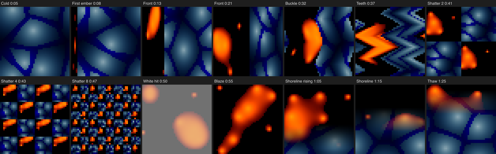
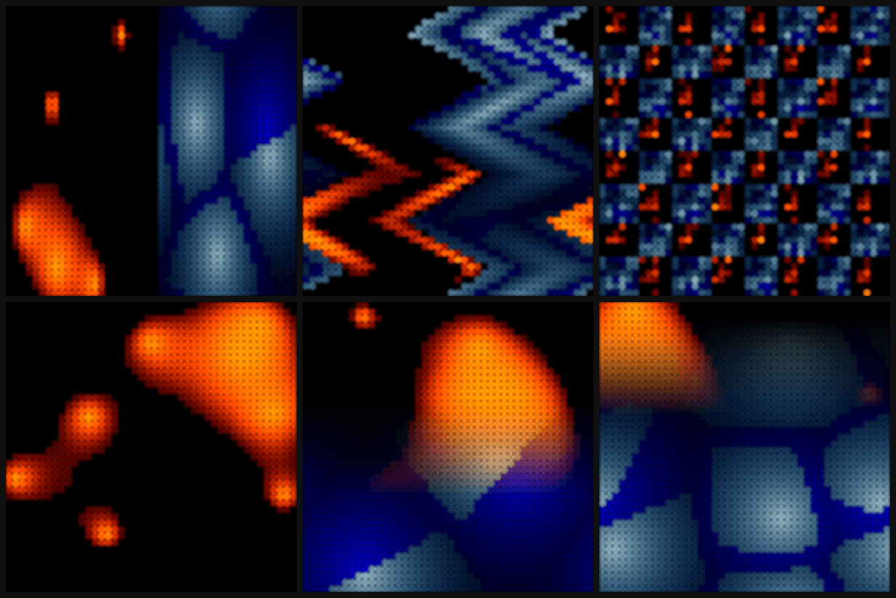

# Ember & Floe: Visual Direction Packet and Visual Performance Plan

Design for #1194 (parent #1191). Nothing here is as-built: no stock Pattern or
Show builder change lands under #1194. The build is a separate
`work:implementation` child cut from this plan.

Jon delegated his gates for this Show on 2026-10-21 ("they take their own
recommendations at my gates", recorded on #1191). Each gate below is a
delegated decision, recorded on #1194 with its reason, for Jon to review when
he previews the build.

**Recommendation in one paragraph.** Build Ember & Floe as a 90 s Portable 2D
Show in which fire and ice share one Stage. Each element keeps its whole world
inside its own territory, and the front line between them is the drama: war
moves the front in held steps, and peace moves it smoothly. Intensity is the
length of the front: a straight line, then a buckled one, then teeth, then a
4 × 4 checkerboard that doubles to 8 × 8. At the peak the board detonates in one white
hit, and fire owns everything. Then ice rises underneath in a soft horizontal
shoreline and thaws the Stage back to cold, which is where the loop begins.

The Show uses two existing ZRanger1 Patterns (MetaballsOfFire2D and IceFloes2D),
one Clip each for the whole Show, six Zone Layouts in seven occurrences, two
split-position tracks and one windowed white color-map. It needs no new Pattern.
The prototype compiles to 48,439 B against the 68,384 B activation proxy, and
passes the flash limit in every second.

## What changed from the draft

The draft in #1191 section 3 (split, then wave, checker, rings and pinwheel,
then a Full Stage takeover and a soft split on y) changes in four ways:

1. **The Layout progression gets one law.** The draft's five-Layout sequence is a
   catalogue of Zone Layout kinds: the rubric's "technique sampler" failure, and
   the draft itself named it as the risk ("the Layout progression has to carry
   the piece"). The refined arc escalates one variable, the length of the front
   line: line, buckle, teeth, then checkerboards of 2, 4 and 8. Rings and
   pinwheel are cut. They change the front's shape without lengthening it in
   order, and rings remap each band into polar coordinates, which bends both
   fields into arcs that read as a third texture.
2. **`span` does not give a Stage-wide field, so the premise uses what it does
   give.** The draft assumed `span` lets both Zones read one Stage-wide field.
   Measured: under Moving Split, Checker and Wave, each Clip samples its region's
   own coordinates, stretched to 0..1. On a deterministic LumaStripes probe the
   right half of a split matched the full-Stage field compressed by 2 (mean
   difference 0.000) and not the same-position field (0.508). This is the
   documented contract (Technical Reference, Routing: "Moving Split renormalizes
   the selected side"; `emitLogicalRoutingSetup` in
   `src/engine/showRoutingRepresentation.ts`), not a defect. Only Full Stage and
   Soft Split pass Stage-wide coordinates. The refined premise turns that into
   the visual law: losing ground compresses a world, and a checkerboard
   shatters it into copies.
3. **The takeover is a position, not a Layout.** Fire owns everything when the
   front reaches the far edge (split position 1). That keeps one law from first
   ember to blaze, and at position 1 the fire's coordinates are Stage-wide, so
   the fire does not jump when the shoreline begins.
4. **The loop closes.** The draft ended on the soft split. The refined arc thaws
   the shoreline to position 0 and returns to the opening's all-ice frame. Both
   shoreline seams are authored steps, not invisible joins; see
   [seams](#section-and-transition-strategy).

## Visual Direction Packet

### Intent and audience

- A Portable Show for any 2D panel or mapped surface: an ambient narrative
  piece about two elements contesting one surface.
- It shows that a Show can draw with Zone Layouts themselves: the boundary is
  the subject, and the Patterns are the materials.
- Audience: the PXLBLZ catalogue's Portable Shows, beside CME Remix and
  Quadrille; builders who want to see what Zone Layouts can carry.
- Form: ambient, 90 s, looping cold to cold.

### Governing premise

**Two worlds, one front.** Fire and ice each keep their whole world inside
their own territory. Only the territory changes. Gaining ground lets a world
sprawl; losing ground compresses it; a broken front shatters both worlds into
copies. War moves the front in held steps; peace moves it smoothly. The front
lengthens until it cannot hold, detonates in white, and then lies down
horizontal.

### Graphic grammar

- **Dominant silhouette:** the front line, a hard edge between orange-on-black
  and blue ice.
- **Supporting primitives:** fire as bounded blobs on black (MetaballsOfFire2D);
  ice as a full field of cracked floes (IceFloes2D).
- **Texture:** each element's own; neither gets a second texture.
- **Edges:** hard while the elements are at war. The only soft edge is the
  shoreline in peace.
- **Glyphs:** none.

### Hierarchy

- **Cold:** ice alone, dimmed: the ground.
- **Front:** the line is the hero; fire is the active voice, ice the resisting
  field.
- **Buckle, teeth and shatter:** the front's shape is the hero; both worlds
  become texture inside it.
- **White hit:** the whole Stage, once.
- **Blaze:** fire alone and sprawling.
- **Shoreline and thaw:** the horizon, with fire above and ice below.
- **Throughout:** fire is the brightest thing, and ice is held at 70%
  brightness so it never outshines fire.

### Palette roles

- **Orange-red** (hue 0 to 0.082) is fire, the aggressor.
- **Pale steel blue with deep-blue cracks** (hue 0.55 to 0.67) is ice, the
  ground.
- **Black** is fire's own ground: the air around the blobs. Fire's territory is
  mostly black, which is what makes its blobs read.
- **White** is the detonation, once per loop.
- **No intruder hue.** The warm violet glow where fire crosses ice in the
  feather appears only in peace. It is the elements' first contact without a
  front, and it leaves when the thaw ends.

### Motion verbs

- **Lurch:** the front moves in held steps on the beat, forward and back.
- **Fracture:** the front changes shape, each step longer than the last.
- **Glide:** in peace the front moves smoothly. It is the only smooth motion in
  the piece.

Each element keeps its own motion inside its territory (fire bounces, ice
drifts); those are textures, not verbs.

### Timing hierarchy

- **Beat:** 625 ms (96 BPM).
- **Bar:** 2.5 s. Front steps and Layout changes land on bars, compressing to
  half bars at the end of the war.
- **Phrase:** 10 s, four bars.
- **Arc:** nine phrases, 90 s, cold to cold.

### Phrase arc

| Section | Time | What happens |
| --- | --- | --- |
| Cold | 0-10 s | Ice alone. On bar 4 (7.5 s) the first ember: a sliver of fire at the left edge. |
| Front | 10-30 s | The front lurches on each bar: fire gains twice, ice answers once, three times over, from 20% to 60%. The last bar compresses to half-bar steps and stalls at the middle. |
| Buckle | 30-40 s | The straight front buckles into a shallow zigzag, then into deep teeth at 35 s. |
| Shatter | 40-50 s | A 4 × 4 checkerboard, then 8 × 8 at 45 s, where both worlds become confetti. |
| White hit | 50 s | The board detonates: the whole Stage flashes white and decays to fire over 1.25 s. |
| Blaze | 50-60 s | Fire owns everything. It has eight blobs now (five before), and they sprawl across the Stage. |
| Shoreline | 60-80 s | On the 60 s downbeat ice surfaces as a faint glow along the bottom edge: the war's last held step. Then the shoreline glides to the middle by 70 s and holds: fire above, ice below. |
| Thaw | 80-90 s | The shoreline glides up to the top edge by 88.75 s, leaving a last band of fire glow there. On the loop's downbeat that band goes out, and the Stage is back to cold. |

### Invariants

- Each element shows only its own texture and colour.
- War moves the front only in held steps; only peace moves it smoothly. Peace
  begins and ends on a held step: ice surfacing at 60 s and the last fire going
  out at the loop.
- Each escalation lengthens the front; nothing else escalates. Measured as
  ownership-boundary edges on the 44 × 44 reference: Front 44, Buckle 120,
  Teeth 238, Shatter 4 264, Shatter 8 616.
- White appears only at the detonation.
- Ice never outshines fire.
- The loop starts and ends on ice alone.

### Permitted variations

The step sizes and order of the war; the beat (80 to 110 BPM); the buckle
amplitude and tooth count; the checker sizes, as long as the boundary-edge
sequence stays increasing (Shatter 2, at 88 edges, is shorter than any Wave
and cannot follow one); the
shoreline height (0.4 to 0.6) and feather (0.25 to 0.5); which element is the
aggressor; the pair of voices, if the replacement keeps one bounded-blobs-on-
black voice and one full-field voice.

### Signature frames and impact moments

**Ordinary frames.**
- **Front:** a vertical edge with orange blobs on black on one side and
  cracked blue ice on the other. In one frame it reads as "fire against ice".
- **Teeth:** a zigzag front, with both worlds folded into it.
- **Shoreline:** fire above, ice below, a warm glow where they meet.

**Impact moments.**
- **The first ember** (minor): fire appears at all.
- **The first answer** (the turn): ice pushes the front back. Now it is a war.
- **Shatter 8** (compression peak): the front everywhere.
- **The white hit** (major, once).
- **The first glide** (the release): the first smooth motion in 60 s.

### Restraint rules

- One Layout at a time and one front; no layered Effects on the Clips.
- White once.
- Steps no faster than half a bar.
- Ice at 70% brightness.
- Fire gets three more blobs only at the detonation, so the change hides under
  the white.
- **Reduced-intensity check:** without the white hit (amount 0) the arc still
  reads, because the detonation is also a Layout change from Shatter 8 to a
  full blaze.

### Known failure modes

- **Fire against ice is a familiar trope.** The front-length law, not the
  colours, has to carry the piece. Answered by the redesign above.
- **A compressed world reads as a glitch rather than as pressure.** Each step
  rescales a world. The steps land on the beat and are held for a bar, so the
  rescale reads as a lurch. Faster steps would read as jitter.
- **The shoreline's fire half goes dark.** Under Soft Split the fire samples
  Stage-wide coordinates, so blobs that drift into the lower half vanish under
  the ice. The prototype's 1:15 frame shows this. Mitigation for the build: hold
  the shoreline at 0.6 rather than 0.5, and choose the frame from captures
  across several seeds.
- **The feather turns muddy.** Measured, it does not: fire's ground is black,
  so the feather darkens ice toward black and lays translucent orange over it,
  which reads as a violet-warm glow, not grey. The prototype's 1:05 and 1:25
  frames show this.
- **Frame rate.** MetaballsOfFire2D evaluates up to eight `hypot` calls per
  pixel. On a full 1,936-pixel panel the hardware frame rate will be low, and
  its blobs advance per frame, not per millisecond, so fire moves slower on
  slow hardware. See the [cost envelope](#cost-envelope).

### Rejected alternatives

- **The draft's Layout catalogue** (wave, checker, rings, pinwheel). There is no
  ordering law, and rings and pinwheel bend both worlds into polar arcs.
- **Stage-wide fields under every Layout.** The engine does not offer it (see
  above). A Soft Split with feather 0 would give Stage-wide coordinates for the
  front, but fire's blobs then roam the whole Stage and are mostly hidden
  behind the ice, so fire's narrow opening territory would usually be empty
  black.
- **A fade-color Transition for the detonation.** It needs split Clips and a
  Transition section, which After Hours measured at about 22 KB. The windowed
  color-map costs about 13.7 KB with no Clip split.
- **Ice as the aggressor.** Ice is a full field and slow; it reads as ground,
  not as an agent.

### Impact rubric scores

Scored against
`.claude/skills/design-compelling-pxlblz-visuals/references/impact-rubric.md`.
The draft column scores #1191 section 3 as written; the refined column scores
this packet.

| Dimension | Draft | Refined | Why |
| --- | ---: | ---: | --- |
| Premise | 2 | 3 | One inferable law: two worlds, one front, and losing ground compresses your world. The draft was clear (fire against ice, conflict vertical, peace horizontal) but borrowed its force from a familiar pairing. |
| Hierarchy | 2 | 2 | The front first, fire over ice by brightness, and white once. Residual risk: in the shatter both worlds become equal-weight confetti. That is intended as the compression peak, but it is the one flat moment. |
| Palette roles | 2 | 3 | Structural: fire's black ground makes its blobs and the feather's glow; white is the single detonation; the violet contact glow exists only in peace. |
| Motion grammar | 1 | 2 | Lurch, fracture and glide, with step against smooth as the war/peace law. The draft had no motion law beyond Layout changes. Not yet a 3: each world's own motion is untouched texture. |
| Temporal form | 1 | 3 | Cold, ember, war with answers, escalation by doubling, detonation, blaze, shoreline and thaw back to cold. The draft's sequence was a catalogue with an ending. |
| Restraint | 2 | 2 | Ice alone for 7.5 s, white once, one Layout at a time, and the only smooth motion withheld for 60 s. The shatter is deliberately everything-on. |
| Ordinary frame | 2 | 2 | The front frame is sound and immediate. The shoreline frame depends on where fire's blobs happen to be (see the failure modes). |
| Surprise | 1 | 2 | Two meaningful turns: ice answers, and the war ends horizontal. The thaw back to cold makes the loop the return. |

Every dimension is at least 2; no redesign is outstanding.

## Visual Performance Plan

Written to the contract in
`.claude/skills/co-design-pxlblz-visual-performance/references/visual-performance-plan.md`.
Every measured figure comes from the probes in the [probe record](#probe-record),
which compiled through the production path (`prepareShowV2ForCompile`, then
`compileShow`) and replayed through `createFastReplayRuntime`. Estimates are
labelled.

### Target

- **Artifact:** a Portable 2D Show in the Portable Shows collection, on the
  `plane` reference map at the catalogue's reference count of 1,936 pixels
  (44 × 44).
- **Duration:** 90 s, `continuous` execution. Both voices carry free-running
  state (random seeds and per-frame motion), so the Show cannot claim the
  deterministic-loop stamp; IceFloes2D is already a named drifting voice in
  `src/pixelblaze/stock/showDeterministicLoop.test.ts`.
- **Controller:** any Pixelblaze with a 2D map of at most 2,000 pixels.
  Exploratory, not commissioned.
- **Zones:** two logical Zones, Ember (zone-1) and Floe (zone-2), each with one
  Main Layer.

### Protected visual purchase

The front line as the subject: a boundary between two worlds that moves in held
steps, lengthens at every escalation, detonates once, and then lies down smoothly. The
purchase is the Layout sequence and the split-position tracks. Every fallback
keeps the stepped front, an increasing front length, the detonation and the glide.

### Visual grammar

**Implementation grammars for the protected purchase**, compared:

| Grammar | Artifact | Verdict |
| --- | --- | --- |
| **A. Zone Layout occurrences plus split-position tracks**, with one Clip per voice across the whole Show | 48,439 B measured, one time section per occurrence | **Chosen** |
| B. One Layer each under a Full Stage Layout, with an animated Aperture or wipe as the front | An Aperture is a rectangle, so no teeth or checker. It needs a key between the Layers, and both voices evaluate on every pixel | Rejected: the front can't change shape, and it doubles the per-pixel work |
| C. A Luma key source (LumaStripes or LumaChevron) as the front | Teeth and stripes are possible, but both voices evaluate on every pixel, plus the key source | Rejected: the most expensive per pixel, and both worlds lose their territories |

**Supporting grammar.**
- **Voices:** MetaballsOfFire2D (`ember`) and IceFloes2D (`floe`), unchanged
  ZRanger1 sources shipped with permission (`docs/agents/stock-content.md`).
- **Layouts:** Front (Moving Split on x), Buckle (Wave on x: two bands,
  amplitude 0.12, frequency 1.5, phase 0.25), Teeth (Wave: amplitude 0.3,
  frequency 3), Shatter 4 and 8 (Checker), and Shoreline (Soft Split on y,
  feather 0.35).
- **Front track:** a `layout-occurrence-split-position` track on occurrence 1,
  with 12 held keys (`hold`, `at: 1`).
- **Shoreline track:** the same kind on occurrence 7, with four sine keys (1, 0.5,
  0.5, 0).
- **Detonation:** a solid color-map on the Ember Clip, (0.75, 0.75, 0.75), whose
  amount track is active only for 50.00-51.25 s: 1 at 50 s, decaying on a cubic
  out to 0. Only the Ember Clip needs it, because fire owns the whole Stage from
  50 s.
- **Blaze:** a held `sliderNumberOfPoints` track on `ember`: 0.25 (five blobs)
  from 0 s and 1 (eight) from 50 s, under the white. The return to five happens
  at the loop seam, where ice covers the whole Stage. The slider re-randomises
  the blobs, so each change must be hidden.
- **Ice level:** Clip brightness 0.7 on the Floe Clip.

### State and identity plan

| Instance | Pattern | Serves | Identity |
| --- | --- | --- | --- |
| `ember` | MetaballsOfFire2D, Speed 0.33 | the Ember Clip, 0-90 s | One clock for the whole Show; the blobs carry through every Layout change |
| `floe` | IceFloes2D | the Floe Clip, 0-90 s | One clock for the whole Show |

Two Clips span the whole Show. Layout occurrences change where each world is
routed, never its state, so no Clip split or Transition is needed.

### Cost envelope

| Ledger | Budget | Planned peak | Evidence or uncertainty |
| --- | ---: | ---: | --- |
| Pattern/source bytes | none set | 3,209 + 3,182 B | Existing stock sources |
| Production artifact bytes | 68,384 B activation proxy (`test/perf-harness/issue514.test.ts`) | 48,439 B (71%) | Measured on the full prototype score |
| Globals and array words | 256 globals; 10,240 words | 57 globals; 6,048 words (4,192 remaining) | Measured |
| Render-target words | 3 × (N + 4) | 5,820 at 1,936 pixels | Ledger formula, `src/engine/showVmResourceLedger.ts` |
| Active Pattern evaluations | none set | 1 per pixel; 2 per pixel only inside the shoreline feather (about 35% of the Stage, 60-90 s) | Routing contract: Soft Split evaluates both sides only inside its feather |
| Expensive operations per active pixel | none set | Fire: 5 `hypot` (8 from 50 s). Ice: 4 `hypot` plus wrapping | Pattern sources |
| Frame time or FPS | 15 FPS working floor (proposed, as After Hours) | Unmeasured. At 1,936 pixels it is likely under the floor on a Pixelblaze 3. Redline measured about 3 FPS at 2,000 pixels, and Vignette 8.2 FPS at 2,000 | Estimate only. `npm run devbench` in the build. A Portable Show runs at the Controller's pixel count, so the realistic targets are 16 × 16 to 32 × 32 panels |

**Marginal costs**, measured on a two-Zone, two-voice Show at 1,936 pixels:
- Base (one Moving Split occurrence, two whole-Show Clips): 11,722 B, 43
  globals.
- **About 2.4 to 2.8 KB** per extra Layout definition in use (Wave 2,492 B,
  Checker 2,393 B, Rings 2,582 B, Pinwheel 2,642 B, Soft Split 2,750 B).
- **About 0.9 KB** per extra occurrence of an existing Layout.
- **About 220 B** per held key on the split-position track (8 keys: 1,756 B).
- A routing transfer between occurrences added 0 B in the probe.
- **An animated color-map is the dominant risk.** Active for the whole Show on
  both Clips, it cost 137 KB (the score compiled to 176,993 B). Windowed to 1.25
  s it cost 21 KB on both Clips, and 13.7 KB on the Ember Clip alone. The build
  must keep the white track windowed.

### Section and transition strategy

- **Steady state:** one Pattern evaluation per pixel; two inside the feather.
- **Boundaries:** atomic Layout switches on bars, with no Transitions. Each
  occurrence boundary is a routing change; Pattern state never resets.
- **Seams:** Front at position 1 hands to the Shoreline at position 1, and the
  Shoreline at position 0 hands to the Front at position 0 (the loop), with
  identical Stage-wide coordinates, so neither voice jumps. Neither seam is
  invisible. Split position is clamped to [0, 1] (`clamp01` in
  `src/engine/showModel.ts`), and Soft Split blends the two sides' RGB linearly
  with `mix = clamp(0.5 + (y - position) / feather, 0, 1)`. So at either
  endpoint a band of half the feather (17.5% of the Stage at 0.35) still holds
  up to 50% of the departing or arriving voice. The score makes both
  appearances authored held steps on a downbeat:
  - At 60 s, ice surfaces as a glow along the bottom edge.
  - At the loop, the last fire glow along the top edge goes out.
  - The thaw reaches 0 at 88.75 s and holds, so that band is still while it
    waits for the downbeat.

| Occurrence | Layout | Time | Mechanism |
| --- | --- | --- | --- |
| 1 | Front | 0-30 s | Held keys: 0 → 0.08 (7.5 s) → 0.2 → 0.32 → 0.24 → 0.4 → 0.52 → 0.44 → 0.6 (25 s) → 0.46 (26.25) → 0.56 (27.5) → 0.5 (28.75) |
| 2 | Buckle | 30-35 s | Static |
| 3 | Teeth | 35-40 s | Static |
| 4, 5 | Shatter 4, 8 | 40-45, 45-50 s | Static |
| 6 | Front | 50-60 s | Position 1: all fire. The white track runs from 50 to 51.25 s |
| 7 | Shoreline | 60-90 s | Sine keys 1 → 0.5 (70 s), hold to 80 s, then linear to 0 at 88.75 s, held to 90 s |

### Expensive purchases

- **Five extra Layout definitions** (about 12.5 KB): the escalation itself. The
  protected purchase.
- **The windowed white color-map** (13.7 KB): the single detonation. Without it
  the Layout change still marks the peak, so it is the first purchase to
  economise.
- **The front track** (about 2.6 KB for 12 keys): the war's lurch and answers.
- **The second voice through the feather** (runtime only): the contact glow.

### Measurement plan

**First slice of the build:** the Show record with occurrences 1-3 and the
front track. Record the three ledgers, then extend to the full score.

**Verification matrix:**
- **The Show:**
  - it validates, reopens and compiles with no blockers;
  - bytes under 68,384 B;
  - globals under 256.
- **Routing:**
  - the front position at sampled times matches the key table (fire fraction
    of the Stage at 13, 21 and 28.75 s);
  - the Checker cell counts at 42 and 47 s, and the increasing boundary-edge
    sequence across Front, Buckle, Teeth and Shatter 4 and 8;
  - at the 60 s and loop seams, no jump in either voice's coordinates, and
    the half-feather band held still on each side of the downbeat.
- **The white hit:** a white frame at 50.0 s, and no white outside
  50.00-51.25 s.
- **The flash limit** over the full 90 s.
- **Census re-pins** per `docs/agents/stock-content.md`, with unchanged
  verdicts.
- **Production-route captures** (`?capture`) of front, teeth, shatter 8, blaze,
  shoreline and thaw.
- **The exported `.pxlshow` and `.epe`** reopened through the artifact oracle.
- **`npm run devbench` FPS**, if a Controller is available; otherwise the frame
  rate stays an estimate, and the Show's note says so.

### Fallback ladder

In order. Each rung keeps the premise.

1. **The detonation.** Replace the animated white with a static white-heat
   Clip segment (a black-to-white color-map at amount 1 for 1.25 s). This
   saves about 3 KB.
2. **The last escalation.** Shatter 8 becomes Shatter 6 (440 edges, still
   longer than Shatter 4). Bytes are unchanged; this trades confetti for
   legibility on small panels.
3. **The buckle.** Drop Buckle and keep Teeth. This saves about 2.5 KB.
4. **The war.** Use fewer front keys. This saves about 220 B a key.

### Handoff

To the build child (`work:implementation`), through `compose-pxlblz-installation-shows`
for Show composition practice (the Show is Portable; the skill's Stage
topology sections do not apply) and the stock-content catalogue chain:

- **The Show:** built in `src/pixelblaze/stock/showsV2.ts` with the authoring
  helpers (`logicalLayout`, `occurrence`, `propertyTrack` and `propertyKey`),
  registered in `showIds.ts` and `showCatalogueV2.ts` under `portable-shows`
  with a notice crediting ZRanger1, and with chapter Markers for Cold, Front,
  Buckle, Shatter, Blaze, Shoreline and Thaw.
- **Census:** re-pins in the fan-out order of `docs/agents/stock-content.md`,
  then a Gallery keyframe if the Show joins the Gallery.
- **No new Pattern.**
- **Push hold:** the build lands on main but stays unpushed until Jon has
  previewed it (#1191).

### Probe record

The probes were temporary `_ember-floe-*-probe.test.ts` files under
`src/pixelblaze/stock/`, deleted before this plan was committed. Their source is
posted on #1194.

| Probe | Command | Answers |
| --- | --- | --- |
| Cost and frames | `npx vitest run src/pixelblaze/stock/_ember-floe-a-cost-probe.test.ts` | Layout marginal costs; first frames of split and soft split |
| Span sampling | `npx vitest run src/pixelblaze/stock/_ember-floe-b-span-probe.test.ts` | Region-local coordinates under Moving Split |
| Full score | `EF_FLASH=1 npx vitest run src/pixelblaze/stock/_ember-floe-c-score-probe.test.ts` | Score bytes and globals; ablations; storyboard; flash limit; white-hit timing |

**Layout cost variants** (two Zones, MetaballsOfFire2D and IceFloes2D, 64 s,
1,936 pixels):

| Variant | Bytes | Globals |
| --- | ---: | ---: |
| Moving Split, one occurrence | 11,722 | 43 |
| Plus a split track with 8 held keys | 13,478 | 43 |
| Split, then Soft Split | 14,472 | 44 |
| Split, then Wave / Checker / Rings / Pinwheel | 14,214 / 14,115 / 14,304 / 14,364 | 46 |
| All six draft Layouts | 23,244 | 53 |
| Split, Soft, Split, Soft (definitions reused) | 15,360 | 50 |
| Split, then Soft, with routing transfers | 14,472 | 44 |

**Score ablations** (the full prototype score; the other rows were measured
with an extra blaze key at 89 s, since removed, which cost 168 B):

| Variant | Bytes | Globals |
| --- | ---: | ---: |
| White color-map on both Clips, track active for 90 s | 176,993 | 65 |
| Without the white tracks | 39,756 | 65 |
| Without the white tracks or Effects | 32,774 | 49 |
| Without any track or Effect | 25,308 | 55 |
| White on both Clips, windowed to 50-51.25 s | 61,174 | 65 |
| White on the Ember Clip only, windowed | 53,284 | 57 |
| **The same without Shatter 2, thaw held from 88.75 s (chosen)** | **48,439** | **57** |
| Static white-heat Clip segment, one step | 50,334 | 57 |
| Static white-heat Clip segment, two steps | 64,684 | 57 |

**Flash limit.** `runTelemetry` from `src/agent-harness/telemetry/harness.ts` on
the compiled score at 1,024 pixels and 30 fps, over 90 s: pass, with no pixel
violating in any second.

**Feather.** In the prototype frames at 65 s and 85 s, fire inside the 0.35
feather reads as translucent orange over darkened ice, with a violet-warm
contact glow and no grey mud.

**Probe pitfall.** IceFloes2D passes saturation up to 1.21, so `hsv` yields
slightly negative channels, which the Controller clamps. An image writer must
clamp to [0, 1]. Without the clamp, the negatives wrap to 255 in a PNG and look
like stray red pixels.

**Storyboard.** The frames are fast-replay output from the production compiler
on the 44 × 44 plane, not captures from the production route; those belong to
the build. They predate the review corrective: the 0:41 frame shows the
since-cut Shatter 2, and the 1:25 frame shows the thaw before it ended at
88.75 s. Image: `docs/plans/images/ember-floe-storyboard.png`.

**Build captures (#1199).** These are production-route frames of the built Show
at `3e5b42e1`, recorded with
`npm run render -- --show stock-show-portable-ember-floe --start T --seconds 0.2 --width 1200`.
Each tile is the first frame of its run. Left to right, top row: Front at 21 s
(fire holds about half the Stage), Teeth at 37 s, and Shatter 8 at 47 s.
Bottom row: Blaze at 52 s (fire alone, eight blobs, after the white hit),
Shoreline at 70 s (ice rises from the bottom edge through the feather), and
Thaw at 85 s (ice reclaims the Stage). Image:
`docs/plans/images/ember-floe-build-captures.png`.

