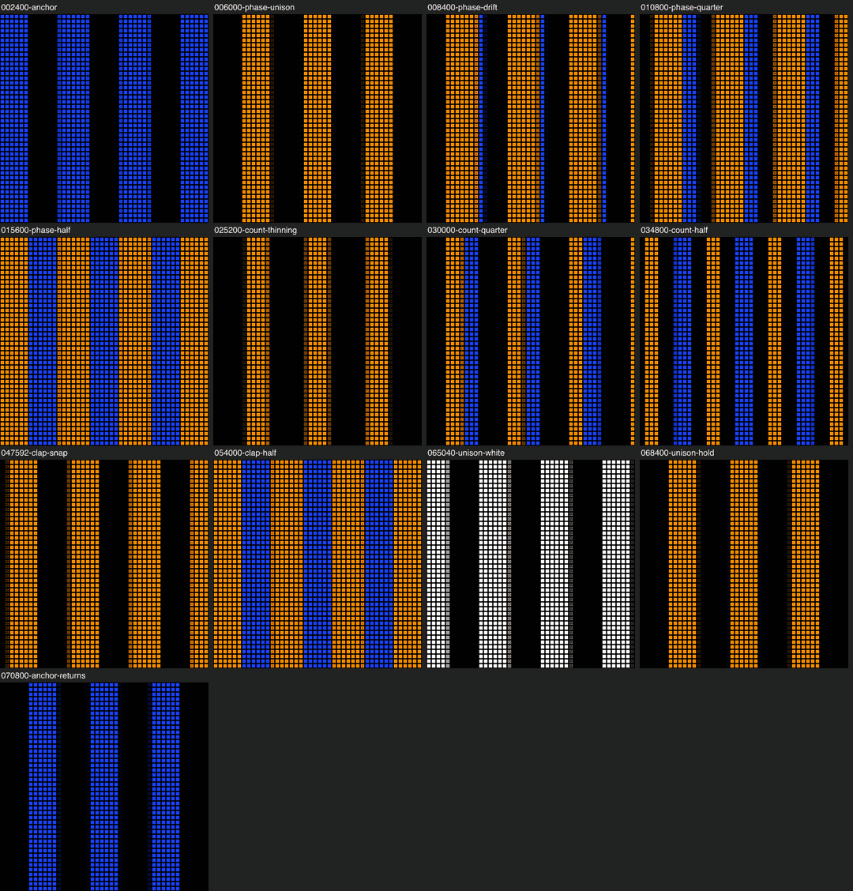
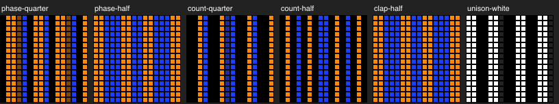

# Phase: Visual Direction Packet and Visual Performance Plan

This is the design for #1195 (parent #1191). Jon delegated his gates for this
Show; each gate decision is recorded on #1195 as "decision (delegated by Jon)"
and listed under [Delegated decisions](#delegated-decisions). Nothing here is
as-built. The Show record lands under a separate `work:implementation` child cut
from this plan, and it stays out of pushes until Jon has previewed it.

**Recommendation in one paragraph.** Build Phase as a Portable Show on the
stock `plane` map. Two instances of the existing LumaStripes, the cobalt
*anchor* and the amber *phaser*, play the same figure. The phaser sits on top
under a luma key, so in unison it hides the anchor completely. One
`instance-time-scale` track speeds the phaser up so that it gains exactly a
quarter loop per drift. How far apart the two voices are then shows as how much
cobalt and black survive under the amber: sparse bars on black in unison, a
full two-colour field at half phase. Three phrases change one variable each:
*Phase* drifts, *Count* thins both voices so they pair instead of covering, and
*Clap* replaces drift with snaps that land on the beat. The final snap lands in
unison on the only white of the piece. No new Pattern is needed. The prototype
compiles to 29,352 B with 91 globals and passes the flash gate at 0%. Precise
replay matches fast replay until 32.77 s; past that point, proof depends on the
compiler repair in #1197.

## Visual Direction Packet

### Intent and audience

- A Portable Show for any square matrix: a process piece in which the viewer
  watches one rule play out, after Steve Reich's *Piano Phase* (1967) and
  *Clapping Music* (1972).
- It shows that a Show can be one law rather than a montage. Nearly the whole
  piece is a single number, the phase difference between two copies of one
  figure, made visible.
- Audience: Pixelblaze builders and the PXLBLZ catalogue, plus anyone who knows
  the music. The piece also teaches the Luma exact-loop contract and Show time
  scaling by example.
- Form: ambient, a 72 s deterministic loop.

### Governing premise

**Disagreement is the only light that changes.** Two players play the same
striped figure, one on top of the other. When they agree, the top voice hides
the bottom one and the Stage shows sparse amber bars on black. As the top voice
pulls ahead, the hidden cobalt voice shows through, and the black fills until at
half phase none is left. Then they agree again. The piece never adds material
and never changes the figure's tempo; it changes only how far apart the two
players stand.

### Graphic grammar

- **Dominant silhouette:** parallel vertical bars, hard-edged, at a pitch of
  about three periods across the Stage.
- **Supporting primitives:**
  - the anchor's cobalt slivers, which appear beside amber bars only as the
    voices disagree;
  - the black gaps, which are the measure of agreement.
- **Texture:** none. Flat colour, with a slight feather on bar edges so the
  motion reads smoothly on low-resolution matrices.
- **Edges:** hard bars against black.
- **Glyphs:** none.

### Hierarchy

- **Hero:** the amber phaser. It is on top, it moves relative to the anchor, and
  it alone carries the white.
- **Supporting:** the cobalt anchor, visible only through disagreement. When it
  is seen at all, it is seen as evidence.
- **Void:** black, the share of the Stage where both voices are dark. It is
  largest in unison and gone at half phase.
- **Punctuation:** one white unison and the phaser's two cuts, in and out.
- **One-second read:** amber bars, and either black or blue between them.

### Palette roles

- **Amber** (`#FF8A00`) is the phaser and the hero.
- **Cobalt** (`#1840FF`) is the anchor, and the colour of disagreement.
- **Black** is agreement and space.
- **White** is exact unison, once, when the last snap lands. It is the
  stripes' own raw light with the amber tint removed: the figure seen bare.
- **No intruder hue.** The intruder is behavioural: the snap in *Clap*.

Amber and cobalt are near-complementary and separate by hue as well as by luma,
which keeps them apart on a dim matrix.

### Motion verbs

- **March:** both figures travel steadily, one period per bar. This never
  stops.
- **Drift:** the phaser eases ahead of the anchor over a bar.
- **Lock:** holding a phase relationship for a bar.
- **Snap:** the phaser jumps ahead by a quarter in 400 ms.

Drift and snap are one verb, "move ahead", at two speeds. Lock is its absence.

### Timing hierarchy

| Scale | Length | What it is |
| --- | --- | --- |
| Beat | 600 ms (100 BPM) | Snap grid in *Clap* |
| Bar | 2.4 s | One stripe period; one drift or one lock |
| Phrase | 8 bars, 19.2 s (Clap: 9) | One full cycle of the phase relationship; one variable |
| Arc | 30 bars, 72 s | Anchor, Phase, Count, Clap, Unison, Anchor |

- The march is on the bar grid, and every drift and snap starts and ends on a
  beat line.
- The phase difference steps through held quarters (0, 1/4, 1/2, 3/4, 0). It is
  never a continuous ramp.

### Phrase arc

| Bars | Time | Section | What happens |
| --- | --- | --- | --- |
| 0-2 | 0-4.8 s | **Anchor** | The cobalt figure alone. |
| 2-10 | 4.8-24 s | **Phase** | The phaser cuts in exactly on top: the whole figure turns amber. It locks for a bar, then drifts a quarter, four times over: thin cobalt slivers, then full alternation with no black, then slivers on the other side, then unison. |
| 10-18 | 24-43.2 s | **Count** | In the unison bar both voices thin to quarter-width bars. The same four drifts now never cover: the voices pair, then alternate evenly with black between, then pair the other way. Black dominates. |
| 18-27 | 43.2-64.8 s | **Clap** | In the unison bar both voices widen again. Drift is replaced by snaps, a quarter each in 400 ms, landing on bars 20, 22 and 24, then compressing: 25, 25.5, 26, 26.5 and 27. The compression stretches the phrase to nine bars. |
| 27-29 | 64.8-69.6 s | **Unison** | The last snap lands on the downbeat of bar 27. The phaser's tint goes to zero for a beat, showing white bars, then decays back to amber over two beats. It holds amber unison for two bars. |
| 29-30 | 69.6-72 s | **Anchor** | The phaser cuts out on the bar line, and the cobalt figure is alone again. The loop restarts in that state. |

Over the piece the phaser gains exactly four loops, one in each of Phase and
Count and two in Clap, and the anchor runs exactly 30. Both clocks therefore
return to their starting phase at the seam.

### Invariants

- One figure. Both voices always share every control except time. A geometry
  change applies to both voices, during a unison bar.
- The phaser only ever moves ahead. It never falls behind and never reverses.
- Phase differences are held as quarters; drifts and snaps go between them.
- The march never stops and never changes tempo.
- Black is present whenever the voices agree.
- White happens once.

### Permitted variations

Width (Count), the speed of moving ahead (Clap's snaps), and the phaser's
presence (in and out at the seam). Nothing else varies.

### Signature frames and impact moments

- **Ordinary frame, unison:** amber bars on black. This is the opening state of
  every phrase and the frame the piece returns to.
- **Ordinary frame, quarter phase:** amber bars, each with a cobalt sliver on
  its trailing side. It reads as a delay, an echo.
- **Peak density, half phase:** a full alternation of amber and cobalt with no
  black anywhere. It is reached quietly, by drifting.
- **Count, half phase:** thin amber and cobalt bars evenly spaced on black.
  Four beats made visible.
- **The rupture:** the first snap in *Clap* at bar 20. After 16 bars of easing,
  the phaser jumps.
- **The impact:** white bars on the downbeat of bar 27, at the final unison.

See the [storyboard](#storyboard).

### Restraint rules

- No hue cycling, no noise and no Effects beyond the two tints and the key.
- White once. No strobe and no presentation flash.
- No added voices: the peak comes from coverage, not from more material.
- The *Count* phrase withholds coverage altogether; black is its subject.
- The cobalt never appears in a frame where the voices agree.

### Known failure modes

- **"Stripes moving" is the generic reading.** The premise survives only if
  the viewer sees that two copies disagree. The cut-in at bar 2, when the whole
  figure turns amber, is the tell: a second player has entered, playing the
  same thing. If preview shows that the cut reads as a recolour rather than an
  entry, the fallback is a one-beat drift-in from a quarter behind.
- **The rigor visible only to the programmer** (the epic's named risk). The
  answer is that the visible quantity, cobalt coverage, is the phase difference
  itself. Nobody needs to know about exact loops to see the field fill and
  empty.
- **Moiré was the epic's mechanism and is rejected here.** Fine-line moiré
  reads only weakly at 44 × 44 and is noise at 16 × 16 (probe 3). Coverage
  reads at both.
- **A quarter's coverage alternates between 0.227 and 0.273 of pixels** while
  bars cross pixel columns. That is integer pixel quantization, not drift error,
  and it is invisible as such.

### Rejected alternatives

1. **Moiré via an angle or scale offset on the phaser** (the epic's draft).
   Rejected: it breaks "one figure", and it does not survive low resolution.
2. **Changing the Luma member per phrase** (Stripes, then Rings, then Pinwheel).
   Rejected: each needs two new instances (an estimated 3 KB or more each), and
   swapping the figure is a catalogue of techniques rather than one law.
3. **A phaser that fades out.** Rejected after probe 4: a dimmed but still
   keyed phaser keeps covering the anchor, so the exit reads as muddy amber.
   The cut mirrors the entry.
4. **A white color-map Effect for the hit.** Rejected after probe 4: color-map
   maps the amber's luma (about 0.6) onto white and produces grey. Removing the
   amber tint shows the stripes' raw full-range white, at the same cost.
5. **Section-splitting to dodge #1197.** Rejected by the eng lead: depend on
   the compiler repair instead of paying about 8.5 KB per extra section.

### Impact rubric scores

Scored against
`.claude/skills/design-compelling-pxlblz-visuals/references/impact-rubric.md`.
The draft column scores the epic's section-4 reference; the refined column
scores this packet.

| Dimension | Draft | Refined | Why |
| --- | ---: | ---: | --- |
| Premise | 2 | 3 | One inferable sentence: two copies of one figure, and you see only their disagreement. The draft named a technique, moiré, rather than what is seen. |
| Hierarchy | 1 | 2 | Amber on top, cobalt as evidence, black as agreement. The draft gave two equal keyed voices. Residual risk: in the half-phase frame amber and cobalt carry equal area. |
| Palette roles | 1 | 3 | Structural: cobalt *is* the phase difference; white *is* exact unison. The draft named no palette. |
| Motion grammar | 2 | 3 | One verb, "move ahead", at two speeds, over a march that never stops. Lock is its absence. |
| Temporal form | 2 | 3 | Each phrase is a complete cycle back to unison, and each changes the composite law: covering, pairing, jumping. The arc ends where the anchor began. |
| Restraint | 2 | 3 | Count withholds coverage; peak density arrives quietly; white happens once; no added material. |
| Ordinary frame | 2 | 2 | Sound rather than iconic. Bars on black and bars with an echo read at once, at 44 × 44 and 16 × 16, but a single frame could be "stripes". |
| Surprise | 1 | 2 | A meaningful turn: after 16 bars of easing the phaser snaps, and the snaps compress into the white unison. It is not yet a rupture that the viewer will remember. |

Every dimension scores at least 2. The two dimensions held at 2 are named as
the preview's targets in the build child's acceptance frames.

### Storyboard

These are fast-replay output from the production compiler on the stock `plane`
map at the 1,936-pixel Portable reference, drawn as dots. They are not Stage
captures; real-Stage captures through `?capture` belong to the build.

Frames, in order: anchor (2.4 s); phase unison (6 s); a drift in progress
(8.4 s); quarter (10.8 s); half (15.6 s); Count thinning (25.2 s); Count quarter
(30 s); Count half (34.8 s); a snap in progress (47.6 s); Clap half (54 s); the
white unison (65 s); the amber unison hold (68.4 s); the anchor returning
(70.8 s).

The same law at 16 × 16:

## Delegated decisions

Jon delegated his gates for this Show on #1191: "Go: principal engineers on
Ember & Floe and Phase, they take their own recommendations at my gates, and
hold new Shows out of pushes until I've seen them." Each decision below is also
posted on #1195 with its reason and evidence.

1. **Packet and plan approved**, with every rubric dimension at 2 or more.
   Ordinary frame and Surprise are held at 2 and named as preview targets.
2. **Coverage instead of moiré** as the visible mechanism (probe 3).
3. **No new Pattern.** LumaStripes carries the piece, so no stock Pattern
   files and no Gallery keyframe are touched.
4. **Portable Shows collection, not the Gallery.** Gallery placement is a
   public-surface choice. Jon makes it after the preview, alongside the push
   decision.
5. **Depend on #1197** rather than split sections (the eng lead's direction).
   Precise proof past 32.7 s waits for that repair.

## Visual Performance Plan

Written to the contract in
`.claude/skills/co-design-pxlblz-visual-performance/references/visual-performance-plan.md`.
Every figure below is measured from the [probe record](#probe-record) unless it
is labelled as an estimate.

### Target

- **Artifact:** a Portable Show in the Portable Shows collection, with a
  portable output contract at the 1,936-pixel reference on the stock `plane`
  map, `executionModel: 'deterministic-loop'`.
- **Duration:** 72 s (30 bars at 100 BPM).
- **Stage:** one logical Zone, `singleLayout`, one Layout occurrence. There are
  two Layers: the anchor on Main, the phaser on an overlay.
- **Controller:** Pixelblaze 3 class. Exploratory; any square matrix.

### Protected visual purchase

- **Hero effect:** the phase difference between two copies of one figure,
  visible as coverage.
- **What the audience perceives:** amber bars on black that gain a cobalt echo,
  fill the Stage, and empty again, and later pair and snap. The figure itself
  never changes speed.
- **Invariants that survive every fallback:**
  - two independent clocks on one Pattern;
  - the phaser keyed on top;
  - exact quarter locks;
  - the loop returning both clocks to phase.

### Visual grammar

- **Cheap supporting materials:** the existing LumaStripes, two color-map
  tints, one luma key.
- **Repetition with variation:** the phrase is a fixed eight-bar cycle (four
  quarter moves, each followed by a held bar, back to unison). Each repeat
  changes one variable: width in Count, the speed of moving ahead in Clap.
- **Palette and temporal roles:** set in the packet above.
- **Rare exception:** the white unison, made by keying the phaser tint's
  `amount` from 1 to 0.

### State and identity plan

- **Shared:** every control target. Both instances get identical
  `controlTargets` and identical `sliderWidth` control tracks.
- **Independent, with the visible reason:** two LumaStripes instances. The
  premise *is* two clocks; one shared instance cannot disagree with itself.
- **Frame-wide state:** LumaStripes' `beforeRender` accumulates its clock and
  computes the heading. The per-pixel path is a projection, one triangle
  waveform and a smoothstep.
- **Controls:**

| Control | Value | Meaning |
| --- | --- | --- |
| sliderLoopInterval | 0.24 | 2.4 s, one bar |
| sliderDirection | 1 | forward |
| sliderSpacing | 0.3333 | pitch 0.3 of the Stage, about 3.3 periods |
| sliderWidth | 0.5, or 0.25 in Count | lit fraction |
| sliderFeather | 0.12 | slight edge softening |
| sliderLean | 0.5 | symmetric |
| sliderAngle | 0.25 | travels right to left; vertical bars |

**The phase mechanism.** The compiler multiplies the delta passed to the
member's `beforeRender` by the instance's time scale
(`src/engine/showCompiler.ts:11258-11263`). LumaStripes accumulates its clock
from that delta and wraps it exactly at the loop length
(`src/pixelblaze/stock/patterns/LumaStripes.js:55-71`). A time-scale bump whose
excess integrates to a quarter of the 2.4 s loop (600 ms) therefore advances the
phaser exactly a quarter period, and it stays locked once the time scale returns
to 1.
- **Drift:** sine-in-out keys at 1, then 1.5, then 1 over one bar. The excess
  averages 0.25 across the bar, which is 600 ms.
- **Snap:** the same shape over 400 ms, peaking at 4, the clamp maximum
  (`src/engine/showModel.ts:2486-2501`). A snap cannot be shorter than 400 ms at
  a quarter step.

### Cost envelope

| Ledger | Budget | Planned peak | Evidence or uncertainty |
| --- | ---: | ---: | --- |
| Pattern/source bytes | none set | LumaStripes, stock | No new Pattern |
| Production artifact bytes | 68,384 B activation proxy (`test/perf-harness/issue514.test.ts`) | 29,352 B | Measured (probe 4) |
| Globals | 256 | 91 | Measured |
| Array words | 10,240 | 6,012 used, 4,228 remaining | Measured. The render target at 1,936 pixels is 3 × (N + 4) = 5,820 words (`src/engine/showVmResourceLedger.ts:3-8`) |
| Active Pattern evaluations | none set | 2 per pixel, always: 3,872 per frame at the reference | Score structure: two full-length Clips, no Transition |
| Expensive operations per pixel | none set | Two LumaStripes crests, two color-maps, one luma key | Score structure |
| Frame time or FPS | none set for Portable | About 5-8 FPS at 1,936 pixels; about 35-45 at 256 | **Estimate**, scaled from pb32 anchors in `docs/reference/Show Rendering Optimization Results.md` (Vignette 16.4 / 8.2 FPS at 1,000 / 2,000 pixels) at two evaluations per pixel. `npm run devbench` in the build replaces it |

**Byte breakdown, measured by variant (probe 4):**
- 28,118 B with no white hit;
- 29,352 B with the white as a whole-Show `clip-effect` track on the tint's
  `amount`;
- 37,229 B with that track windowed to 1.9 s. Windowing adds two section
  boundaries, so the whole-Show track is cheaper here. That is the opposite of
  the many-occurrence case in Ember & Floe (#1194), because this Show has one
  Layout occurrence.

The 67 property keys: 49 on the phaser's clock, 8 on the two width tracks,
5 on the phaser's entry and exit, and 5 on the white. Headroom under the proxy
is 39 KB.

**Flash limit.** Measured with `runTelemetry` from
`src/agent-harness/telemetry/harness.ts` at 30 fps over the full 72 s:
- 0.000 of pixels flash above 3 Hz in the worst second, at both 256 and 1,936
  pixels;
- the snaps are at least 600 ms apart;
- the white is one flash on 48% of the Stage.

### Section and transition strategy

- **Steady-state depth:** two evaluations per pixel, composited by the luma key.
- **Peak depth:** the same; no Transition anywhere.
- **Sections:** the whole Show is **one compiled time section**. Every event is
  a key on a whole-Show track. Both Clips span 0-72 s; the phaser's entry and
  exit are brightness keys.
- **Dependency on #1197:** a section longer than 32.767 s is exactly the shape
  #1197 breaks under Precise replay, and presumably on hardware. The eng lead
  directed that Phase depend on that repair rather than split sections (lane T).
  Until it lands:
  - fast-replay and editor proof stand;
  - Precise proof past 32.7 s waits for the repair;
  - Precise replay already matches fast replay for every lock through 30 s
    (probe 2).

### Expensive purchases

- **The second LumaStripes instance:** the premise itself. A single instance
  cannot disagree with itself.
- **49 time-scale keys:** the phase score, about 6 KB at the roughly 121 B per
  key measured for After Hours (#1192). The snaps' compression is the first
  economy (see the ladder).
- **The white tint key:** about 1.2 KB, measured (28,118 B to 29,352 B). It is
  the single impact.

### Measurement plan

**First slice of the build:** the Show record in `showsV2.ts` with the full
score, which is small. Prove these:
- it validates, reopens and compiles with no blockers, in one time section;
- bytes are under the proxy and globals under 256;
- **a lock oracle:** at the middle of every held bar, the anchor's visible share
  of the Stage equals the planned phase coverage within one pixel column. The
  expected values are 0, 0.25, 0.5 and 0.25 for full width, and 0.25 at every
  non-unison lock for quarter width;
- **the loop seam:** the frame at 2.4 s equals the frame at 74.4 s;
- the flash gate passes at 256 and 1,936 pixels;
- after #1197 lands, Precise replay matches fast replay at every lock.

**Then:**
- census re-pins in the fan-out order of `docs/agents/stock-content.md`, with
  unchanged verdicts;
- real-Stage captures through `?capture` of the four signature frames and the
  white unison;
- the exported `.pxlshow` reopened through the artifact oracle;
- `npm run devbench` FPS where hardware is available, labelled as such.

### Fallback ladder

These are in order, and each keeps the premise.
1. **Clap's compression.** Snap a half loop on bars 20, 22, 24 and 26 instead
   of eight quarter snaps; the gain is still two loops. This removes 12 keys,
   about 1.5 KB. A half-loop snap needs 800 ms at the clamp.
2. **Count.** Drop the phrase; the Show becomes Anchor, Phase, Clap and Unison
   at 52.8 s. This saves the width tracks and 12 clock keys.
3. **The white.** Drop it. Unison stays legible as black returning, and this
   saves 1.2 KB.
4. **Resolution.** This changes frame rate only. A Portable Show runs at the
   viewer's map size, and the law reads at 16 × 16.

### Handoff

To the build child (`work:implementation`), through
`compose-pxlblz-installation-shows`, whose stock-Show mechanics apply to a
Portable Show too:
- **The Show:** `phaseV2()` in `src/pixelblaze/stock/showsV2.ts`, built through
  the authoring helpers. Its id, catalogue entry and organization rail go in
  `showIds.ts`, `showCatalogueV2.ts` and `stockEntityOrganization.test.ts`, with
  census re-pins. These are hot files shared with other Show lanes; tell the eng
  lead before editing them.
- **No new Pattern:** none of the five-piece stock Pattern files are touched.
- **Gallery:** not added. A Gallery entry and keyframe follow Jon's preview,
  if he chooses (see the delegated decisions).
- **Proof:** the lock oracle, the seam, the flash gate, real-Stage captures and
  the reopened export.
- **Open questions:**
  - #1197, for Precise and hardware past 32.7 s;
  - hardware FPS at the reference size.

### Probe record

The probes were temporary files under `src/pixelblaze/stock/_phase-*-probe.test.ts`,
deleted before this plan was committed. They compiled through the production
path (`prepareShowV2ForCompile`, then `compileShow`) and replayed through
`createFastReplayRuntime` at main `8ac557c3`.

| Probe | Answers |
| --- | --- |
| 1. Four-phrase prototype (Phase, Angle, Ratio, Clap) | The time-scale mechanism gives exact quarter locks in fast replay: 0, 0.227, 0.455, 0.227 and 0, at both 16 ms and 33 ms steps. Under Precise, the phaser vanished from 18 s. |
| 2. Precise bisection | The cause is section-local time emitted in milliseconds (`showCompiler.ts:5087-5091`), filed as #1197. Precise matches fast at every lock through 30 s. A time-scale track stops gaining at 32.8 s. |
| 3. Moiré variants (pitch 0.06 and 0.1; angle 0.015 and 0.03 turns; scale 1.15) at 1,936 and 256 pixels | Moiré is weak at 44 × 44 and noise at 16 × 16, so it is rejected. |
| 4. Final score (this plan) | Bytes by white mechanism; locks at every half bar; the loop seam delta of 0.00000; the flash gate at 0.000; the storyboard; and the fixes for the fade and the grey white. |
